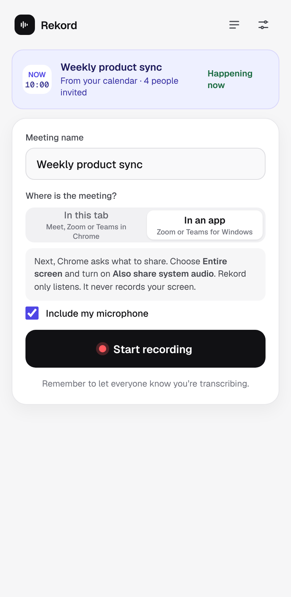
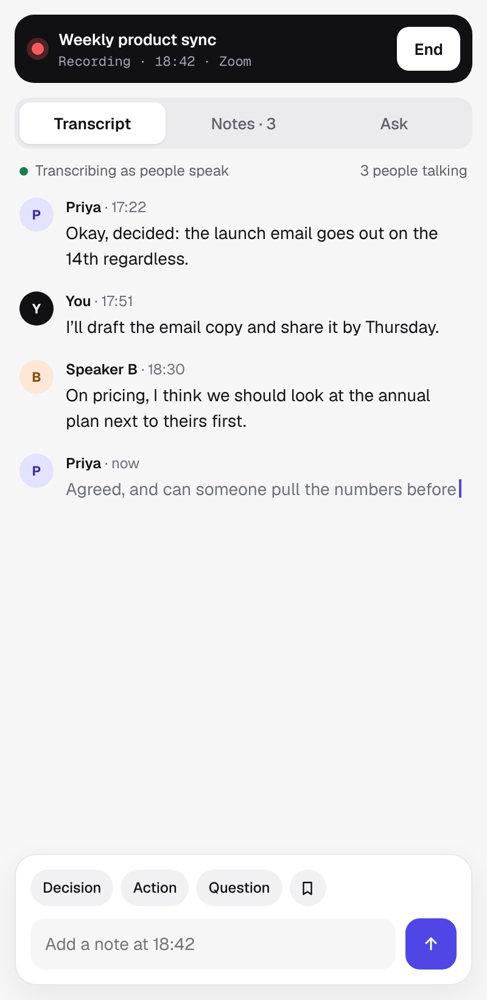
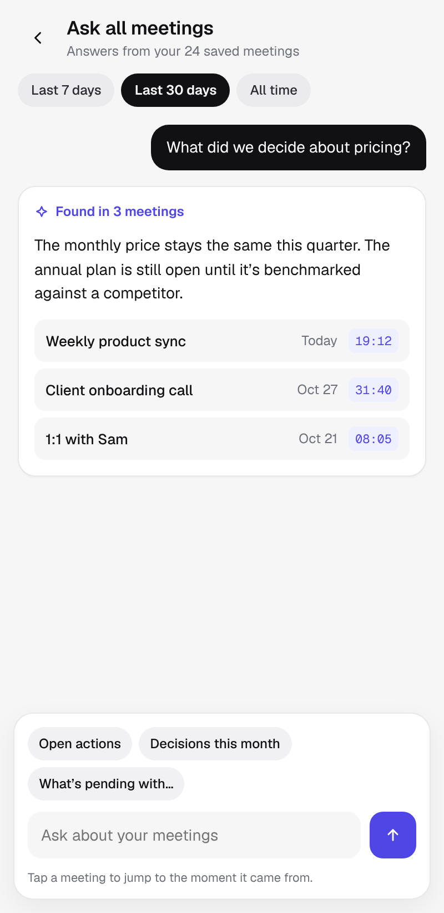
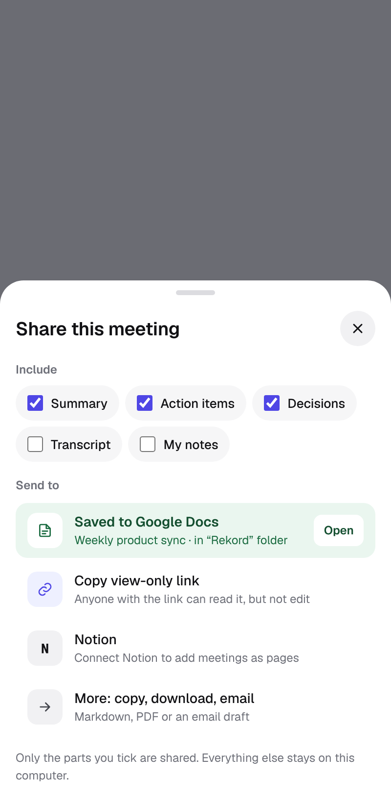

# Rekord

Rekord is a Chrome side-panel extension for meetings.
Rekord records your meetings, transcribes them and writes the notes for you.

## What Rekord does

- You can record a meeting in a Chrome tab or in a desktop app such as Zoom or Teams.
- You can also record your microphone if you choose.
- A live transcript shows while people talk.
  - With a Deepgram key, words appear as people speak.
  - Deepgram also tells the voices apart.
- You can type notes and add markers during the meeting.
- You get a summary and action items.
- You can ask questions about one meeting, while the meeting is running or after.
- You can ask questions across all your meetings with "Ask all meetings".
- Speaker names are suggested, and you can correct them.
  - Needs a Deepgram key.
- You can export a meeting as Markdown or PDF.
- You can share a meeting to Google Docs or Notion.
- Google Calendar names your meetings.

## Screenshots

<p>




</p>

- Start: choose where the meeting is.
- Live: the transcript updates as people speak.
- Ask all meetings: ask a question across every meeting.
- Share: save a meeting to Google Docs or Notion.

## Install from source

You need Node.js and npm.
The repo does not pin a Node version.

```bash
npm install
npm run build
```

Then load the build in Chrome:

1. Open `chrome://extensions`.
2. Turn on **Developer mode**.
3. Click **Load unpacked** and choose `.output/chrome-mv3`.

To work on Rekord, run `npm run dev` instead of `npm run build`.

## First run

1. Click the Rekord icon to open the side panel.
2. Pick a setup:
   - **Free to start**
     - One Groq key does everything.
     - Your transcript appears a few seconds after people speak.
   - **Real time**
     - You need a Deepgram key and a Groq key.
     - Words appear as people speak.
     - Deepgram is a paid service.
   - **Choose my own**
     - You pick the service for transcription and for the assistant.
3. Add your keys in one of two ways:
   - **Paste a key**
     - Rekord recognises Groq, OpenAI, Anthropic, OpenRouter, Deepgram and Notion keys.
   - **Connect [Penv Cloud](https://penv.cloud)**
     - One-click connect works only in the published extension.
     - In a build from source, choose **Use a token instead**.
     - Then paste a Penv Cloud token.

You can get a free Groq key at https://console.groq.com/keys.

## Optional: Google Calendar and Docs

Google sign-in works in every build: Rekord ships a fixed extension ID and a public Google OAuth client
(Web application, sign-in through `chrome.identity.launchWebAuthFlow`). Everything else works without Google.

1. Open Settings, then Connected apps, and connect Google.
2. Chrome asks to let Rekord reach Google; Google then asks which parts to allow.

The owner's one-time Google Cloud steps, and how to use your own client (`WXT_GOOGLE_CLIENT_ID`,
`WXT_EXTENSION_KEY`), are in [docs/GOOGLE.md](docs/GOOGLE.md).

## Optional: Notion

Create an internal integration at https://www.notion.so/profile/integrations.
Paste the integration's secret into Rekord.
If you use Penv Cloud, store the secret there as `NOTION_TOKEN`.

## Development

```bash
npm test
npm run compile
```

- `npm test` runs the unit tests.
- `npm run compile` type-checks the code.
- Plans, specs and design frames live in the [specs repo](https://github.com/Itzfeminisce/productivity-apps-engineering-specs/tree/main/apps/rekord).

## Privacy

- Your meetings, transcripts and settings stay in your browser (IndexedDB).
- Your data leaves your computer in two cases only:
  - Rekord sends audio and text to the AI services you chose.
  - You share a meeting.
- Your API keys are kept in session storage.
- Session storage is cleared when you close the browser.
- Rekord has no tracking or analytics.

Read [docs/privacy.md](docs/privacy.md) for details.
